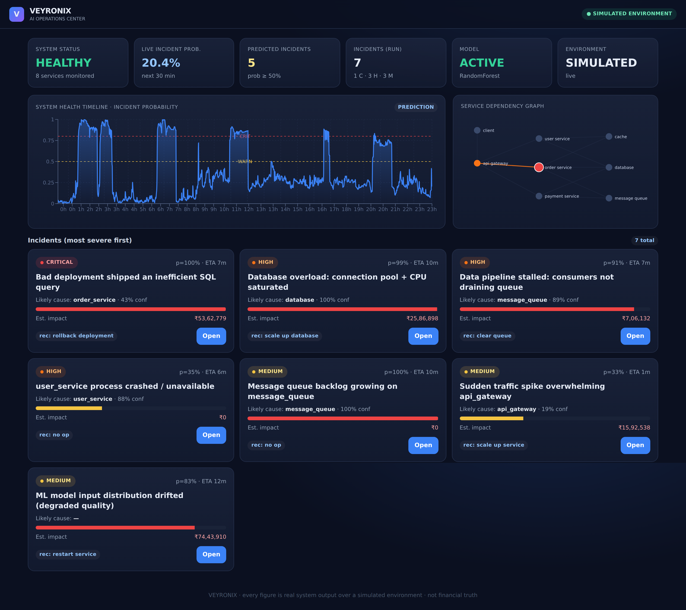
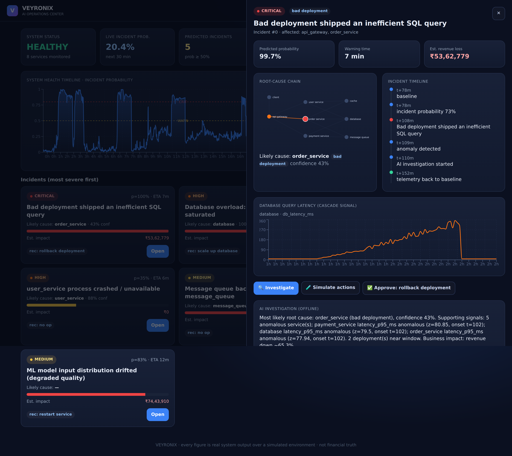

# VEYRONIX

### Predictive Incident Intelligence for Modern Systems

**Predict. Investigate. Simulate. Remediate.**

Veyronix is an AI-powered operations intelligence platform that predicts incidents before they escalate, investigates their root causes, evaluates possible interventions, and enables safe, human-approved remediation.

Built around a deterministic data and machine learning layer, a grounded AI investigation layer, and a policy-enforced remediation system, Veyronix brings the incident response lifecycle into one coherent platform.

<p align="center">
  <a href="https://github.com/vedantjaiswal001/Veyronix/actions"></a>
  
  
  
  <a href="LICENSE"></a>
</p>

<p align="center">
  <a href="#quickstart">Get Started</a> |
  <a href="#architecture">Architecture</a> |
  <a href="#evaluation">Evaluation</a> |
  <a href="#safety-model">Safety Model</a> |
  <a href="#roadmap">Roadmap</a>
</p>

---

## At a glance

| Capability | Description |
|---|---|
| Predictive monitoring | Estimate the probability of an incident within a configurable future horizon |
| Anomaly detection | Identify unusual system behavior, including held-out failure scenarios |
| Root cause analysis | Rank likely causes using service dependencies and supporting evidence |
| AI investigation | Gather evidence through controlled tools and generate grounded incident reports |
| Counterfactual simulation | Compare potential interventions and estimate their operational impact |
| Safe remediation | Enforce allowlists, approval requirements, and auditable execution |
| Model observability | Evaluate predictive performance and monitor operational behavior |
| Operations dashboard | Explore system health, incidents, dependencies, and investigation results |

**Project scope:** 11 implementation phases, approximately 6,900 lines of Python, a React and TypeScript dashboard, and 111 automated tests reported by the project test suite.

Veyronix currently operates on a simulated microservice environment. It is designed as an extensible foundation for real-world operations intelligence, not as a claim of production validation against live infrastructure.

## The idea

Traditional monitoring tells you that something has already gone wrong. Veyronix aims to help answer the questions that come before, during, and after an incident.

1. **Predict:** Is the system approaching an incident?
2. **Investigate:** What changed, and which signals support the diagnosis?
3. **Attribute:** Which service or failure mechanism is the most likely cause?
4. **Simulate:** What might happen if we intervene, or do nothing?
5. **Recommend:** Which intervention offers the best estimated outcome?
6. **Approve:** Is the proposed action permitted and authorized?
7. **Remediate:** Can the action execute within a controlled safety boundary?
8. **Measure:** Did the intervention improve the observed outcome?

The result is a complete operational reasoning loop rather than another alerting dashboard.

## Product interface

### Operations Center



The Operations Center brings together system health, incident probabilities, dependency relationships, severity rankings, and recommended actions. It is designed to help an operator move from a system-wide signal to a specific investigation.

### Incident Investigation



The investigation interface brings together the root cause chain, event timeline, supporting signals, AI-generated analysis, and remediation approval flow.

These screenshots represent the project's demonstrated interface. The runtime experience depends on the local API, generated telemetry, and current application state.

## Architecture

Veyronix separates deterministic operational computation from AI-assisted investigation and policy-controlled execution.

```text
                SIMULATED PRODUCTION ENVIRONMENT
                               |
                               v
                 Telemetry and Event Ingestion
                               |
                               v
                  Validation and Feature Pipeline
                               |
                               v
                 +---------------------------+
                 | Predictive ML             |
                 | Incident and Anomaly      |
                 | Detection                 |
                 +---------------------------+
                               |
                               v
                 +---------------------------+
                 | Root Cause Intelligence   |
                 | Service Dependencies      |
                 | Evidence and Attribution  |
                 +---------------------------+
                               |
                               v
                 +---------------------------+
                 | AI Investigation Layer    |
                 | Controlled Tools          |
                 | Evidence-Grounded Reports |
                 +---------------------------+
                               |
                               v
                 +---------------------------+
                 | Counterfactual Simulation |
                 | Impact and Recommendation |
                 +---------------------------+
                               |
                               v
                 +---------------------------+
                 | Safety and Authorization  |
                 | Policy Checks and Approval|
                 +---------------------------+
                               |
                               v
                 Remediation and Audit Trail
                               |
                               v
                    Outcome Measurement
```

### Design principles

**Deterministic computation first**

Predictions, metrics, threshold selection, and evaluation are produced by explicit code and reproducible data pipelines. The language model is not the authority for benchmark numbers or execution permissions.

**Evidence before explanation**

The investigation layer uses controlled tools and available operational evidence to construct its diagnosis. Its conclusions should be traceable to the signals and observations that support them.

**Simulation before intervention**

Candidate interventions can be evaluated before execution. Estimated business impact is treated as a model output, not as a guarantee of financial results.

**Human authority over remediation**

The AI layer can investigate and recommend. It cannot bypass the remediation policy to execute arbitrary actions.

For the complete technical design, see [Architecture](docs/architecture/ARCHITECTURE.md) and [Security](docs/architecture/SECURITY.md).

## Evaluation

Veyronix includes a reproducible evaluation suite covering incident prediction, anomaly detection, previously unseen failures, root cause attribution, and AI investigator behavior.

The project reports the following results from its evaluation workflow. See the linked reports for the complete tables, experimental configuration, and failure analysis.

| Evaluation area | Reported result |
|---|---|
| Incident prediction | PR-AUC of 0.50 for the best reported Random Forest model |
| Precision at low false-positive rate | 85% precision at a reported 1% false-positive rate |
| Early warning | Median warning time of 14 minutes |
| Incident detection comparison | 30% for ML versus 7.7% for the static threshold baseline, under the reported evaluation |
| Anomaly detection | AUROC of 0.90 for Isolation Forest |
| Held-out cascading failure | 84% detection rate with 8.5% false-positive rate |
| Root cause attribution | Top-1 accuracy of 0.90 and Top-3 accuracy of 0.92 across 71 incidents |
| AI investigator | Reported root-cause score of 0.90, hallucination rate of 0.0%, and tool success rate of 100% |

These are reported project results, not independently verified production benchmarks. Their interpretation depends on the dataset, split strategy, definitions, and evaluation configuration documented by the project.

### Reproduce the results

```bash
make features
make train
make evaluate
```

The evaluation reports are written under `docs/evaluation/`.

- [Benchmark results](docs/evaluation/RESULTS.md)
- [Failure analysis and limitations](docs/evaluation/FAILURES.md)
- [ML methodology](docs/ml/METHODOLOGY.md)

The comparison suite evaluates static thresholds, ML-only prediction, anomaly-only detection, and combined detection. This helps expose where individual components contribute value and where they still fail.

## Safety model

Veyronix treats remediation as a security boundary, not as an unrestricted tool call.

The safety design includes:

- Allowlisted remediation actions.
- Policy validation before execution.
- Human approval for controlled actions.
- Audit logging for remediation decisions.
- Explicit restrictions on destructive operations.
- Separation between AI-generated recommendations and executable authority.

The project permanently blocks `DELETE_DATABASE` in its remediation policy. The AI investigator cannot use natural-language instructions to grant itself unrestricted execution rights.

The current remediation implementation is a controlled project environment. Production deployment would require additional integration-specific authorization, identity, secret management, observability, and operational safeguards.

See the [Security documentation](docs/architecture/SECURITY.md).

## Technology stack

| Layer | Technologies |
|---|---|
| Language | Python |
| API | FastAPI, Uvicorn |
| Data processing | Pandas, NumPy, DuckDB |
| Machine learning | scikit-learn and project-specific evaluation pipelines |
| Persistence | SQLAlchemy, SQLite, PostgreSQL support |
| Frontend | React, TypeScript, Vite |
| Visualization | Dashboard charts and service dependency graph |
| AI investigation | Tool-driven agent orchestration and model-provider abstraction |
| Interoperability | Model Context Protocol server |
| Testing and quality | pytest, Ruff |
| Infrastructure | Docker, Docker Compose, Kubernetes manifests |
| Observability | Prometheus and Grafana configuration |
| Migrations | Alembic |

See [`pyproject.toml`](pyproject.toml) for the Python dependencies and development tooling.

## Quickstart

The local workflow is designed to run without API keys or external infrastructure. The default LLM provider is offline.

### Prerequisites

- Python 3.11 or later.
- Node.js 22 for the frontend.
- Git.
- GNU Make, or an equivalent way to run the commands in the `Makefile`.

Docker is optional for the local workflow.

### 1. Clone the repository

```bash
git clone https://github.com/vedantjaiswal001/Veyronix.git
cd Veyronix
```

### 2. Install dependencies

```bash
make install
```

This target creates the project's virtual environment and installs the configured core, ML, and development dependencies.

### 3. Initialize the database

```bash
make init-db
```

The default local setup uses SQLite.

### 4. Build the operational dataset

```bash
make simulate
make features
```

These commands generate simulated telemetry and assemble the feature dataset used by the predictive pipeline.

### 5. Train and evaluate the models

```bash
make train
make evaluate
```

Evaluation outputs are written to `docs/evaluation/`.

### 6. Start the API

Open a terminal in the repository root and run:

```bash
make run
```

The API is available at:

- API: http://localhost:8000
- Interactive API documentation: http://localhost:8000/docs

### 7. Start the dashboard

Open a second terminal in the repository root and run:

```bash
make web
```

The Vite development server is available at:

- Dashboard: http://localhost:5173

Keep the API and dashboard terminals running while using the application.

### 8. Run the flagship demo

From the repository root:

```bash
make demo
```

The demo exercises the Bad Deployment Cascade scenario, including incident prediction, root cause investigation, intervention recommendation, approval, and controlled execution.

### 9. Run the test suite

```bash
make test
```

To run lint checks separately:

```bash
python -m ruff check veyronix tests
```

Refer to the [Makefile](Makefile) for the available commands and their implementation.

## Full-stack infrastructure

For the containerized environment, Veyronix includes Docker Compose configuration for the API, web dashboard, PostgreSQL, Redis, Prometheus, and Grafana.

Create a local environment file:

```bash
cp .env.example .env
```

Then start the stack:

```bash
docker compose up --build
```

The configured service ports are:

| Service | Local address |
|---|---|
| Web dashboard | http://localhost:3000 |
| FastAPI | http://localhost:8000 |
| Grafana | http://localhost:3001 |
| Prometheus | http://localhost:9090 |

The full-stack setup requires Docker and the configuration specified in the repository. If a service does not start, inspect its container logs and verify the environment settings.

For deployment details, see [Deployment](docs/deployment/DEPLOYMENT.md).

## Repository structure

```text
Veyronix/
├── .github/
│   └── workflows/       # CI configuration
├── data/
│   └── raw/             # Raw-data directory placeholder
├── docs/
│   ├── architecture/    # Architecture and security
│   ├── deployment/      # Deployment instructions
│   ├── evaluation/      # Results and failure analysis
│   ├── ml/              # ML methodology
│   └── screenshots/     # Dashboard screenshots
├── infrastructure/
│   ├── docker/          # Container build definitions
│   ├── grafana/         # Dashboards and data sources
│   ├── kubernetes/      # Kubernetes manifests
│   └── prometheus/      # Metrics collection
├── migrations/          # Database migrations
├── tests/
│   ├── agents/
│   ├── end_to_end/
│   ├── integration/
│   ├── ml/
│   ├── security/
│   └── unit/
├── veyronix/
│   ├── agents/
│   ├── api/
│   ├── core/
│   ├── db/
│   ├── eval/
│   ├── features/
│   ├── ingestion/
│   ├── mcp/
│   ├── ml/
│   ├── observability/
│   ├── remediation/
│   ├── rootcause/
│   ├── simulation/
│   └── simulator/
├── web/                 # React and TypeScript dashboard
├── docker-compose.yml
├── Makefile
├── pyproject.toml
└── README.md
```

## Current scope and limitations

Veyronix is an engineering and research project built around a simulated production environment.

The following limitations are important:

- Synthetic telemetry cannot capture every behavior of a real production system.
- Incident prediction and root cause attribution are dependent on data quality, scenario coverage, and the evaluation split.
- Unknown-failure detection is evaluated against defined held-out scenarios, not every possible failure.
- Counterfactual outcomes and business-impact estimates depend on the assumptions encoded in the simulator.
- An offline AI investigator is not equivalent to a live hosted model.
- A successful local demo does not establish production readiness.
- Real-world remediation requires integration-specific controls and operational validation.

These limitations are part of the project's evaluation scope, not claims that the system has solved every production reliability problem.

## Roadmap

### Real telemetry integrations

Connect OpenTelemetry, Prometheus, and service-specific observability systems to replace or supplement simulated telemetry.

### Online learning and drift response

Introduce validated feedback loops for model recalibration, drift detection, and model lifecycle management.

### Richer causal inference

Improve causal discovery, dependency-aware diagnosis, and root cause evaluation across more complex failure patterns.

### Production remediation adapters

Add infrastructure-specific remediation integrations with scoped credentials, stronger authorization, explicit rollback strategies, and audit requirements.

### Broader evaluation

Expand the set of unseen failure scenarios, cross-environment experiments, and reproducible comparisons against established monitoring baselines.

## Contributing

Contributions are welcome, particularly in the areas of evaluation quality, reproducibility, observability integrations, safe remediation, and developer experience.

A useful contribution should:

1. Describe the problem it addresses.
2. Include tests for new behavior or regressions.
3. Preserve the separation between AI recommendations and remediation authorization.
4. Document changes to experimental methodology or benchmark results.
5. Avoid presenting unmeasured outcomes as established results.

Before submitting a change, run:

```bash
python -m ruff check veyronix tests
python -m pytest -q
```

## License

Veyronix is distributed under the MIT License. See [LICENSE](LICENSE) for details.

Copyright 2026 Vedant Jaiswal.

---

<p align="center">
  <strong>Veyronix</strong><br>
  Predictive intelligence for safer, more informed operations.
</p>
